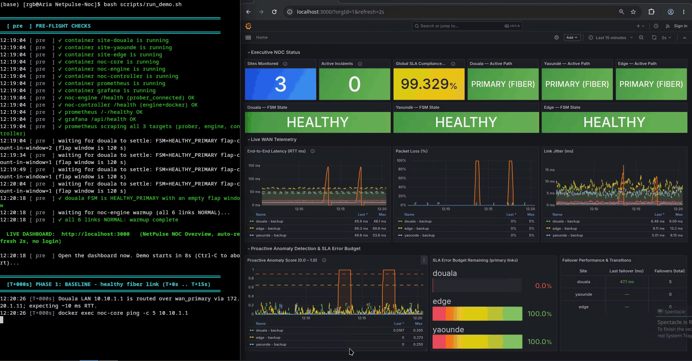

# NetPulse NOC

**Containerized Multi-Site WAN Monitoring, Proactive Anomaly Detection & Automated SD-WAN Failover Platform**


**NetPulse NOC** is an end-to-end Network Operations Center (NOC) and automated failover platform modeled after redundant B2B telecom topologies (primary dedicated fiber + secondary microwave/4G backup). Rather than mocking network metrics, it runs **real ICMP and TCP probes** over Docker-isolated virtual WANs shaped with **Linux `tc`/`netem`**, detects gradual link degradation before a **99.9% SLA** breach occurs, and executes **real Linux kernel routing updates (`ip route replace`)** to fail traffic over automatically.

---

## Live Demo



*Automated 2-minute scenario (`./scripts/run_demo.sh`): Baseline fiber health (`~10ms`) → Proactive `DEGRADING` detection during gradual latency drift → Complete fiber cut & automated failover to backup (`~45ms`) → Hold-down timer & clean failback to primary.*

---

## System Architecture

```mermaid
flowchart TB
    subgraph wan["Virtual Enterprise WAN (Docker)"]
        direction LR
        d["site-douala<br/>10.10.1.1/32"]
        y["site-yaounde<br/>10.10.2.1/32"]
        e["site-edge<br/>10.10.3.1/32"]
        fi["fault_injector.py<br/>Linux tc / netem"]

        fi -.->|"Inject Faults"| d
        fi -.->|"Inject Faults"| y
        fi -.->|"Inject Faults"| e
    end

    subgraph control["Control and Telemetry Plane"]
        core["noc-core<br/>C++20 Prober :9100"]
        eng["noc-engine<br/>EWMA + Isolation Forest :9200"]
        ctrl["noc-controller<br/>Failover FSM + Alerter :9300"]
    end

    subgraph obs["Observability Stack"]
        prom["Prometheus :9090"]
        graf["Grafana NOC Dashboard :3000"]
    end

    core -->|"Primary Fiber and Backup 4G Probes"| d
    core -->|"Primary Fiber and Backup 4G Probes"| y
    core -->|"Primary Fiber and Backup 4G Probes"| e

    core -->|"JSON Telemetry"| eng
    eng -->|"Health and SLA Status"| ctrl
    ctrl -->|"ip route replace"| core

    core -->|"metrics"| prom
    eng -->|"metrics"| prom
    ctrl -->|"metrics"| prom
    prom --> graf```

---

## Key Engineering Decisions

* **Real Kernel Packet Emulation over Mocked Data:** Every site container is dual-homed across `wan_primary` (`172.20.1.0/24`) and `wan_backup` (`172.20.2.0/24`) with Linux `tc`/`netem` queuing disciplines and a virtual enterprise LAN loopback (`10.10.X.1/32`). Failover reroutes real IP packets via `ip route replace` inside `noc-core`.
* **Zero-Dependency C++20 Probing Agent:** Built directly on POSIX raw ICMP sockets, non-blocking TCP sockets, and `poll()` with one isolated worker thread per `(site, link)` pair—ensuring a dead link never stalls telemetry for healthy sites. Computes rolling mean, p95 RTT, jitter, and packet loss in a fixed-size sliding window.
* **Two-Stage Proactive Anomaly Detection with Baseline Freezing:** Combines a fast statistical layer (**EWMA + Z-score** with a variance floor to prevent false positives on stable fiber) and a multivariate **Isolation Forest** over `[rtt_mean, rtt_p95, jitter, packet_loss]`. Baseline updates freeze during active degradation so slow latency drift cannot poison the reference distribution.
* **Production-Safe Failover State Machine:** Implements a 5-state FSM (`HEALTHY_PRIMARY`, `DEGRADED_WARNING`, `FAILED_OVER_BACKUP`, `RECOVERY_HOLD`, `FLAP_LOCKED`) featuring:
  * **Dual-link outage protection** (prevents route thrashing if both links fail).
  * **Hold-down timer (`20s`)** to verify primary link stability before failing back.
  * **Flap dampening** that locks unstable links onto backup until manual operator acknowledgment via API.

---

## Quickstart

### Prerequisites
* Docker & Docker Compose v2
* Python 3.10+ (for running `topology/fault_injector.py` from the host)

### 1. Launch the Full Stack
```bash
git clone https://github.com/ibrahimamam1/netpulse-noc.git
cd netpulse-noc
docker compose up -d --build
```

### 2. Open the Live NOC Dashboard
Navigate to **[http://localhost:3000](http://localhost:3000)** — Grafana is pre-provisioned with anonymous access and loads the **NetPulse NOC Overview** dashboard automatically.

### 3. Run the Automated End-to-End Demo
```bash
chmod +x scripts/run_demo.sh
./scripts/run_demo.sh
```

The script waits for the 30-second baseline warmup, then orchestrates a live **latency drift**, **fiber cut + automated failover**, and **link restoration + hold-down recovery** on `site-douala` while verifying real packet routing to `10.10.1.1`.

---

## Manual Fault Injection CLI

You can inject and inspect real network faults on any site and link at any time:

```bash
# View active tc/netem rules and link status across all 3 sites
python3 topology/fault_injector.py status

# Gradual latency ramp (tests proactive EWMA / Isolation Forest warning before hard SLA breach)
python3 topology/fault_injector.py --site douala --link primary --fault latency-drift --duration 30

# Complete primary fiber cut (triggers automated failover to wan_backup)
python3 topology/fault_injector.py --site douala --link primary --fault fiber-cut

# Bursty congestion / microwave rain fade (10% correlated packet loss)
python3 topology/fault_injector.py --site yaounde --link primary --fault packet-loss-burst --loss 10

# Rapid link flapping (triggers FLAP_LOCKED state)
python3 topology/fault_injector.py --site edge --link primary --fault flapping

# Restore clean baseline parameters
python3 topology/fault_injector.py --site douala --link primary --fault reset
```

To release a `FLAP_LOCKED` site after stabilizing the link:
```bash
curl -X POST http://localhost:9300/api/v1/failover/edge/ack
```

---

## Services & Endpoints

| Service | Container | IP (`wan_primary`) | Host Port | Key Endpoints |
| :--- | :--- | :--- | :--- | :--- |
| **C++20 Prober** | `noc-core` | `172.20.1.10` | `9100` | `/metrics`, `/api/v1/telemetry`, `/health` |
| **Anomaly & SLA Engine** | `noc-engine` | `172.20.1.20` | `9200` | `/metrics`, `/api/v1/status`, `/api/v1/incidents`, `/health` |
| **Failover Controller** | `noc-controller` | `172.20.1.30` | `9300` | `/metrics`, `/api/v1/failover/status`, `/api/v1/failover/events`, `/api/v1/failover/{site}/ack` |
| **Prometheus** | `prometheus` | `172.20.1.40` | `9090` | `/targets`, `/graph` |
| **Grafana** | `grafana` | `172.20.1.41` | `3000` | Auto-provisioned NOC Dashboard |

---

## Repository Structure

```text
netpulse-noc/
├── docker-compose.yml              # 8-container topology + observability stack
├── topology/                       # Layer 1: Dual-homed Alpine sites & fault injector
│   ├── Dockerfile
│   ├── entrypoint.sh
│   └── fault_injector.py
├── prober/                         # Layer 2: Zero-dependency C++20 ICMP/TCP prober
│   ├── CMakeLists.txt
│   ├── Dockerfile
│   └── src/
├── engine/                         # Layer 3: EWMA + Isolation Forest & 99.9% SLA tracker
│   ├── Dockerfile
│   ├── anomaly.py
│   ├── sla_tracker.py
│   └── main.py
├── controller/                     # Layer 4: Failover FSM, Linux route driver & alerter
│   ├── Dockerfile
│   ├── fsm.py
│   ├── router_driver.py
│   ├── alerter.py
│   └── main.py
├── monitoring/                     # Layer 5: Prometheus & auto-provisioned Grafana
│   ├── prometheus.yml
│   └── grafana/
│       ├── provisioning/
│       └── dashboards/noc_overview.json
└── scripts/
    └── run_demo.sh                 # Automated 4-phase live demo
```

---
